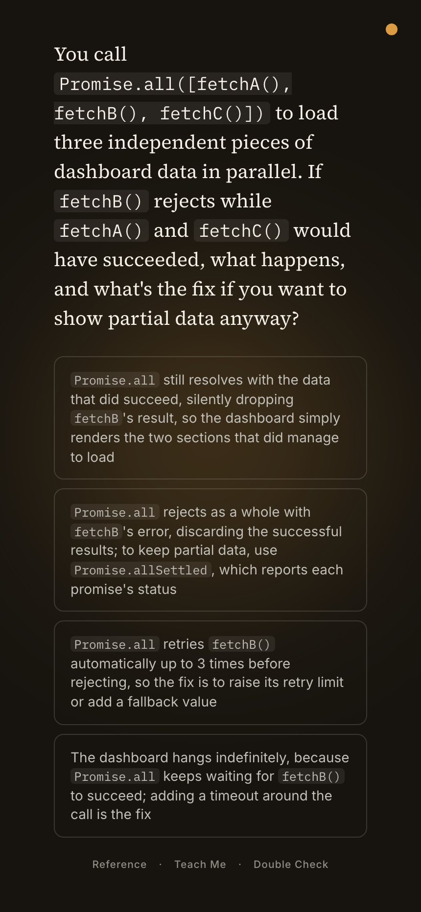
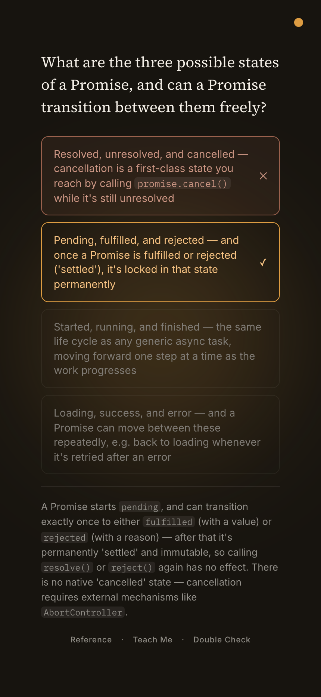
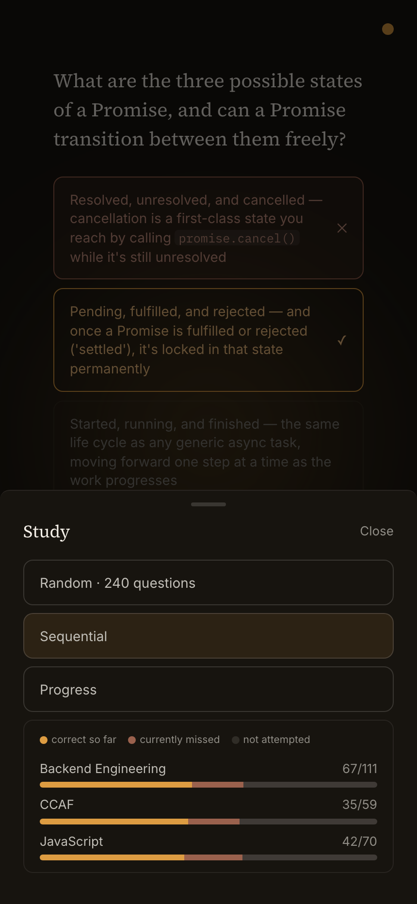

# Study Loop

A phone-first study app: one question at a time instead of scrolling. Its question bank is written and checked by an AI content pipeline that doesn't trust its own output.

**[Try it on your phone →](LIVE_DEMO_URL)** · works offline · installable

<p align="center">
  
  &nbsp;
  
  &nbsp;
  
</p>

Topic-agnostic and easy to customize: point the pipeline at any subject and it builds a reviewed question bank for it (the live app has 240). Every answer is explained, with a ready-made prompt to take to an LLM for more. No accounts, streaks or scores.

## The content pipeline

Three [Claude Code](https://claude.com/claude-code) commands ([`.claude/commands/`](.claude/commands/)) plus deterministic checks ([`scripts/`](scripts/)):

- **`/discuss`** plans a batch: reads current coverage per topic, splits the request into non-overlapping sections, and decides per section whether facts need web verification.
- **`/generate`** writes each section in a parallel subagent, then hands the batch to agents that didn't write it: an adversarial reviewer that tries to break every question, and a web-searching fact-checker for fast-moving topics. It also accepts questions written elsewhere and runs the same checks. Anything that fails is dropped, never quietly patched.
- **Mechanical checks** ([`check-bias.mjs`](scripts/check-bias.mjs)) run on every batch: answer-position spread, whether the correct answer stands out by length or wording, and explanations that cite options by letter. A [Claude Code hook](.claude/settings.json) also runs them automatically whenever Claude edits question files, and blocks on a hard failure, so the rules don't depend on Claude remembering them.
- **`/merge`** waits for a human sign-off, assigns answer positions in code ([`rebalance-positions.mjs`](scripts/rebalance-positions.mjs)), and reports bias stats for the whole bank.

### Issues it caught, and what changed

| Issue | What the pipeline does now |
|---|---|
| The correct answer was clearly the longest option in 97% of one topic's questions | Measured on every batch; flagged questions are dropped. Now 0% across all topics |
| Answer positions skewed: "A" was correct in 42% of another topic's questions | Positions are assigned in code, never by the model. Now ~25% each |
| Explanations cited "Option B", which pointed at the wrong option once options moved | Hard failure in the check |
| Reasoning added to a wrong option was itself true, making it defensible | The reviewer checks for this explicitly |
| Correct options *sound* different: brackets and examples on the right answer, "always"/"never" on the wrong ones | Measured and reported on every batch; cleanup is next |

## The app

- **Offline-first.** A hand-written, 70-line service worker ([`public/sw.js`](public/sw.js)). Answering never touches the network.
- **One endpoint, locked.** The optional progress backup (Vercel Blob) requires a shared secret. Visitors' progress never leaves their browser.
- **Decisions on paper.** [`PROJECT_BRIEF.md`](PROJECT_BRIEF.md) (spec) and [`PLAN.md`](PLAN.md) (build log), including what was deliberately left out and why.

Built spec-first with Claude Code, reviewing generated code and content against the spec.

**Stack:** Next.js 16 · React 19 · TypeScript · Tailwind CSS 4 · Vercel + Blob

## Run locally

```bash
git clone https://github.com/jessy-p/quiz-app.git
cd quiz-app
npm install
npm run dev
```

Node 20+. No environment variables needed: progress lives in `localStorage`.

## Make it yours

- **Questions:** add `data/questions/<topic>.json` (schema in [`types/question.ts`](types/question.ts)) and register it in [`lib/questionPool.ts`](lib/questionPool.ts), or generate a set with `/discuss`, `/generate` and `/merge` in Claude Code. Check any bank with `node scripts/check-bias.mjs`.
- **Deploy:** import the repo into [Vercel](https://vercel.com/new). No environment variables needed. For the optional progress backup, connect a Vercel Blob store (this sets `BLOB_READ_WRITE_TOKEN` for you), add a `BACKUP_SECRET`, then open `/?backup=<secret>` once on each device. Details in [`.env.example`](.env.example).
